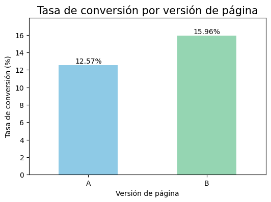
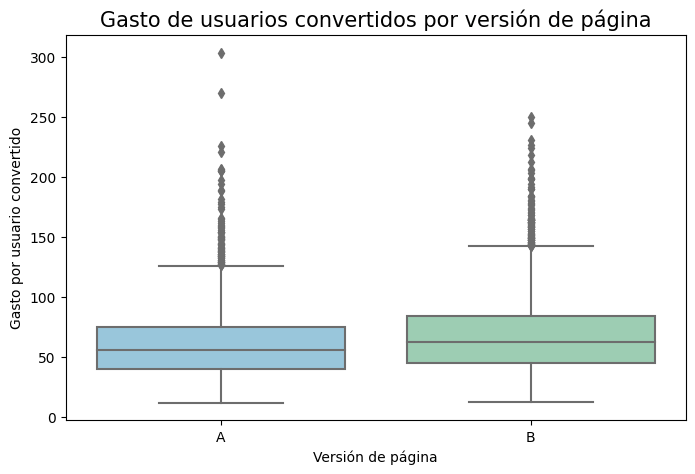
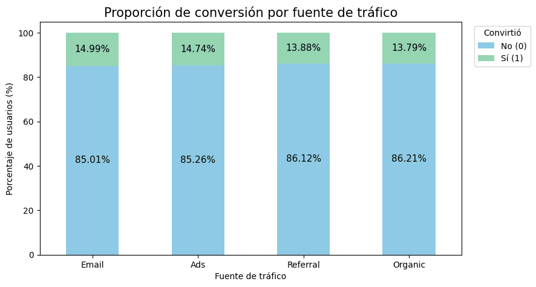
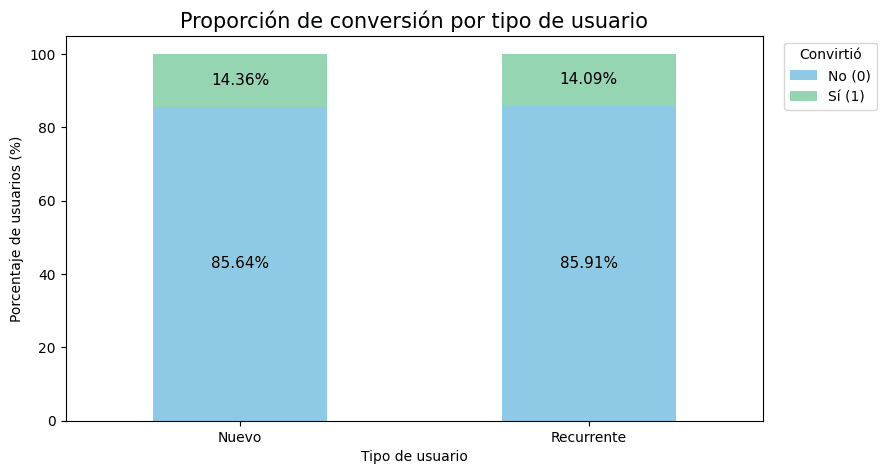

# Landing Page A/B Test: Validating Business Hypotheses with Statistical Tests

**TripleTen Data Analyst Bootcamp project (2026)** | Python · pandas · SciPy · statsmodels · Seaborn

An e-commerce company ran an A/B experiment on its landing page, showing version **A** (control) or version **B** (test) to 40,000 users over 28 days. This analysis answers one question for the digital marketing team: **which version should be implemented**, based on conversion rate, average spend, traffic source and user type?

## 🗂️ Data

40,000 users (one row per user, each exposed to a single version) and 9 columns, with no missing values or duplicates:

| Type | Columns |
|---|---|
| Experiment | landing version (A / B), exposure date (January 1–28, 2026) |
| Segments | region (5), device (mobile, desktop), traffic source (organic, ads, email, referral), user type (new, returning) |
| Outcomes | converted (0/1), spend (0 when the user did not convert) |

The experiment is balanced (19,982 users in A and 20,018 in B), and every segment is distributed almost identically between both versions, so the groups are comparable.

## 🛠️ Methods

Each question was answered with the test that fits the type of variable, after checking its assumptions. Significance level: α = 0.05.

| Question | Test | Assumptions checked |
|---|---|---|
| Average spend per converted user, A vs B | Welch's t-test, confirmed with Mann-Whitney U | Normality (Shapiro-Wilk), equal variances (Levene) |
| Conversion rate, A vs B | Two-proportion z-test | At least 10 successes and failures per group |
| Traffic source vs conversion | Chi-square test of independence + Cramér's V | Expected frequencies above 5 |
| User type vs conversion | Chi-square test of independence | Expected frequencies above 5 |

Spend was compared only among users who converted, because non-converted users always have a spend of 0.

## 💡 Key findings

| Metric | Page A | Page B | Difference | p-value |
|---|---|---|---|---|
| Conversion rate | 12.57 % | **15.96 %** | +3.38 pp (+26.9 %) | 3.8e-22 |
| Average spend per purchase | 61.09 | **68.75** | +7.66 (+12.5 %) | 3.6e-21 |
| Revenue per exposed user | 7.68 | **10.97** | about +43 % | — |

- **Page B wins on both conversion and spend.** Its advantage holds in every traffic source, user type, device and region, and on 27 of the 28 days of the experiment.
- **Traffic source matters, but only slightly.** The association is significant (p = 0.034) but very weak (Cramér's V = 0.015): email (14.99 %) and ads (14.74 %) convert slightly better than referral (13.88 %) and organic (13.79 %). Organic still brings the largest volume of conversions (43.5 %).
- **User type does not matter.** New (14.36 %) and returning users (14.09 %) convert at the same rate (p = 0.474).

  
  

  
  

## ✅ Recommendations

- Implement page B for all traffic: it increases both conversion (+26.9 %) and spend per purchase (+12.5 %).
- Prioritize email and ads for their efficiency, and improve the experience for organic traffic, the channel with the most volume and the lowest rate.
- Keep a single page for new and returning users and focus segmentation on traffic source instead.
- Keep monitoring conversion and spend after the launch to rule out a novelty effect.

## ⚠️ Limitations

- The experiment lasted 28 days, so a novelty effect or seasonality cannot be ruled out.
- The difference between traffic sources is significant because of the large sample, but its practical effect is small, and the data does not include acquisition costs per channel.
- There is no data on margins, returns or repeat purchases.

## 📁 Files

| File | Description |
|---|---|
| `landing_page_ab_test.ipynb` | Full analysis with code, charts and conclusions (in Spanish) |
| `images/` | Charts used in this README |
| `requirements.txt` | Python libraries used |

The dataset was provided by the TripleTen platform and is not included in this repository.

## 🧰 Skills demonstrated

Python · pandas · A/B testing · hypothesis testing · Welch's t-test · Mann-Whitney U · two-proportion z-test · chi-square test · Cramér's V · assumption checking · data visualization with Seaborn · business recommendations from statistical results
